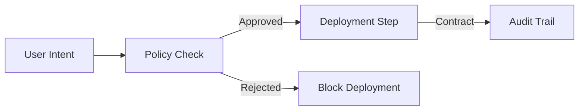

# GlassOps Architecture & Design

> **Target design.** Only part of the `glassops` CLI exists today. The rest of this page describes intent, not working code. The GitHub Action runtime that this page once described was replaced by the CLI.

---

## 1. High-Level Architecture

GlassOps is designed container-first. CI (GitHub Actions today) holds secrets and starts the run, and the `glassops` container decides whether the run may proceed.

### The Control Loop

### Component Breakdown

1.  **CI (GitHub Actions)**: Owns secrets and starts the run.
2.  **`glassops` CLI** (partly built): Plans the change set, evaluates policy, signs a PERMIT, and deploys only under a valid PERMIT. See the [CLI reference](../reference/cli.md).
3.  **Deployment step** (not built): Executes the deploy and normalizes its output.
4.  **Record format** (not built): The message format (SARIF/OTel) exchanged between components.

---

## 2. Governance Flow (The Pipeline)

The target flow is four phases. The CLI implements parts of phases 1 to 4.

1.  **Phase 1: Policy Resolution**
    - Today the policy comes from `glassops.yaml` only.
    - Target: merge `GitHub Vars` (Floor) + `devops-config.json` (Team) + `Salesforce CMDT` (Additive) into one `Effective Policy`.

2.  **Phase 2: Architectural Validity**
    - Today `gate` evaluates the v1 rules over the plan, the CI context and earlier results. See [PERMIT and rules](../reference/permit-and-rules.md).
    - Target: enforce **Hard Invariants** (e.g., No RunAllTests in Prod).

3.  **Phase 3: Simulation (The Dry Run)**
    - Partly built. `validate` runs a check-only deploy. Target: also generate a **Draft Contract**.

4.  **Phase 4: Execution Gate**
    - Partly built. `gate` signs a PERMIT and `deploy` refuses to run without a valid one. Target: compare the **Draft Contract** with the **Effective Policy**.

---

## 3. Security Model

### Confused Deputy Protection

**Principle:** Salesforce never holds deployment secrets. CI holds secrets and authenticates to Salesforce with the JWT flow.

- **Benefit:** If Salesforce is compromised, they cannot deploy to other envs. If GitHub is compromised, scope is limited to the specific repo environment.

### Secrets Management

- **Location:** GitHub Secrets (Environment Scoped).
- **Rotation:** Not automated. Rotate JWT keys on your own schedule.

---

## 4. Failure Modes & Recovery

| Failure | Behavior | Recovery |
| --- | --- | --- |
| **GitHub Down** | Deployment Impossible | Manual `sf deploy` from local machine (Break Glass) |
| **Salesforce Down** | Workflow Fails Gracefully | Retry when service restored |
| **Policy Block** | Workflow Fails (Intentional) | Fix code or Request `Manual Override` |

---

## 5. Directory Structure

- `cmd/glassops` and `internal/`: The `glassops` CLI. This is the only code with working behaviour.
