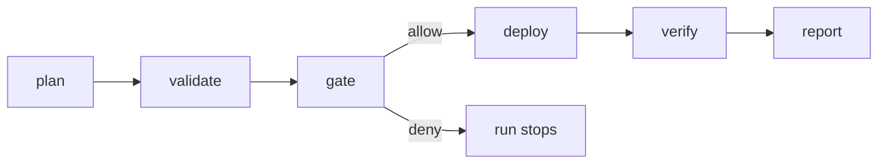

# GlassOps Architecture

This page describes how the released `glassops` CLI is put together. Everything here is in v1.1.0. For the commands and flags, see the [CLI reference](../reference/cli.md).

---

## 1. The idea

GlassOps is one command line tool that runs inside your CI. The CI holds the secrets and starts the run. GlassOps works out what changed, checks it, decides whether it may be deployed, deploys it, and then checks that the target holds what was planned.

The decision is a file. `glassops gate` writes a signed PERMIT, and `glassops deploy` refuses to touch a target without a valid one for exactly this change.

---

## 2. Components

| Part | What it does |
|---|---|
| **CI system** | Holds secrets, starts the run and supplies the commit, the pull request and the approvals. GitHub Actions, Bitbucket Pipelines and GitLab CI are supported. The last two have not run on a real runner yet |
| **`glassops` CLI** | One Go binary, also shipped as a container image. Each step is its own command, and `glassops run` runs a named pipeline of them |
| **Provider** | The part that talks to the deploy target. Salesforce is built in. Provider `exec` runs your own commands for any other deploy tool. See [the exec provider](../reference/exec-provider.md) |
| **Config** | `glassops.yaml` names the targets, their tiers, the policy rules and the pipelines. See the [configuration reference](../reference/config.md) |
| **Result files** | Every step writes one JSON result to `.glassops/results/`. Later steps and `report` read them |
| **PERMIT** | The signed decision in `.glassops/permit.json`. See [PERMIT and rules](../reference/permit-and-rules.md) |

---

## 3. The deploy pipeline

The default `deploy` pipeline runs six steps against one target.

1. **`plan`** works out the change set between two git refs. With no `--from`, it starts from the git tag `glassops/deployed/<target>`, which marks the last commit deployed to that target. With no tag yet, the whole source is planned.
2. **`validate`** runs a check-only validation of the change set against the target. It never deploys. It records which plan it validated.
3. **`gate`** evaluates the policy rules over the plan, the CI context and the earlier results, then writes a signed PERMIT. A deny is written and signed too, and the run stops.
4. **`deploy`** verifies the PERMIT first, then checks that the working tree is the PERMIT's commit with no modified tracked files, then logs in and deploys. When the PERMIT holds a passed validation of this plan, it quick deploys that validation. It then moves the deployed tag.
5. **`verify`** reads the target back and checks that it holds what the plan says.
6. **`report`** summarises every result as markdown and SARIF. It also runs after a failed step.

The default `pr` pipeline runs the checks without a deploy. See [Run a pipeline](../guides/run-a-pipeline.md).

---

## 4. The PERMIT

A PERMIT records one decision: whether one plan may be deployed to one target. It binds to the target, the commit, the plan, the change set and the config. Change any of them after `gate` ran and the PERMIT no longer matches.

- **Rules.** `gate` runs seven built-in rules: `plan_not_empty`, `window.<tier>`, `blackout`, `coverage_min`, `destructive_needs_label`, `separation_of_duties` and `analyzer_max_severity`. Every rule runs, so a deny lists every reason.
- **Fail closed.** Missing evidence is never a pass. A tool problem while gathering evidence denies.
- **Signing.** By default the PERMIT is signed with HMAC-SHA256 using `GLASSOPS_PERMIT_KEY`. On GitHub Actions it can be signed keyless with Sigstore instead. See [Sigstore signing](../reference/sigstore-signing.md).
- **Your own rules.** Optional [Rego rules](../reference/rego-rules.md) run after the built-in rules. They can add denials and can never turn a deny into an allow.

---

## 5. Security model

### Secrets stay in CI

The deploy target never holds deployment secrets. CI holds them and passes them to GlassOps as environment variables. `glassops.yaml` only names the variables, so no secret value goes in the file.

### The signing key stays out of pull request jobs

Anyone who can run a job with `GLASSOPS_PERMIT_KEY` can sign an allow. Keep the key in a protected CI environment that only the deploy job uses. `glassops doctor` warns when the key is set on a pull request run. Sigstore signing removes the shared key.

### The org Id guard

Before any step does anything to a target, the guard compares the org the login reached with the target in the config. A mismatch stops the command. Tier `prod` needs a production org and tier `ephemeral` needs a scratch org.

### Isolated logins

Every command that talks to a Salesforce org runs the Salesforce CLI with its own temporary home directory. It never reads or writes the logins on the machine, and the directory is removed when the command ends.

### What is never logged

Results, annotations and error messages never contain tokens, private keys, auth URLs, the org's company name or full usernames.

---

## 6. Results and evidence

- Every command exits 0 on pass, 1 on a failed check and 2 on a tool error.
- Every step writes `.glassops/results/<step>.json` in one envelope, described by [`schemas/result.json`](https://github.com/glassops-platform/glassops/blob/main/schemas/result.json).
- `gate` writes the facts it evaluated to `.glassops/facts.json`.
- `report` writes a markdown summary and SARIF.
- Opt-in extras are a pull request comment and OpenTelemetry export. See [PR comment and OpenTelemetry](../reference/pr-comment-and-telemetry.md).

---

## 7. Failure modes

| Failure | Behaviour | Recovery |
|---|---|---|
| **Policy denies** | `gate` exits 1 with a signed deny. `deploy` never starts | Fix the change, or meet the rule, and run again |
| **Evidence cannot be gathered** | `gate` denies and exits 2 | Fix the tool or network problem and run again |
| **PERMIT does not match** | `deploy` exits 2 before any login | Run `gate` again for the current commit and plan |
| **Login reaches the wrong org** | The guard exits 2 | Fix the target Id or the credentials |
| **CI is down** | No deploy runs | Deploy by hand with your deploy tool, outside GlassOps |

---

## 8. Repository layout

- `cmd/glassops`: the CLI entry point.
- `internal/cli`: one file per command.
- `internal/core`: config, policy, PERMIT, guard, pipeline, report and telemetry.
- `internal/providers`: the Salesforce and `exec` providers.
- `internal/ci`: the GitHub, Bitbucket, GitLab and local CI layers.
- `schemas`: the JSON schemas for the config and the result files.
- `examples`: working layouts for each CI system.
