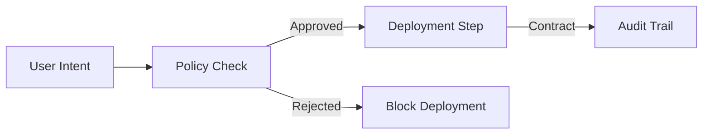

# GlassOps Architecture & Design

> **Target design.** Only the runtime in `packages/runtime` exists today. The rest of this page describes intent, not working code.

---

## 1. High-Level Architecture

GlassOps is designed container-first. CI (GitHub Actions today) holds secrets and starts the run, and the runtime container decides whether the run may proceed.

### The Control Loop

### Component Breakdown

1.  **CI (GitHub Actions)**: Owns secrets and starts the run.
2.  **Runtime** (`packages/runtime`, exists): Reads policy, checks freeze windows, authenticates, and writes a permit and a contract.
3.  **Deployment step** (not built): Executes the deploy and normalizes its output.
4.  **Record format** (not built): The message format (SARIF/OTel) exchanged between components.

---

## 2. Governance Flow (The Pipeline)

The target flow is four phases. The runtime implements only parts of phases 1 and 2.

1.  **Phase 1: Policy Resolution**
    - Today the runtime reads `devops-config.json` only.
    - Target: merge `GitHub Vars` (Floor) + `devops-config.json` (Team) + `Salesforce CMDT` (Additive) into one `Effective Policy`.

2.  **Phase 2: Architectural Validity**
    - Today the runtime can call the Salesforce CLI code analyzer when enabled in config.
    - Target: enforce **Hard Invariants** (e.g., No RunAllTests in Prod).

3.  **Phase 3: Simulation (The Dry Run)**
    - Not built. Target: run a check-only deploy and generate a **Draft Contract**.

4.  **Phase 4: Execution Gate**
    - Not built. Target: compare the **Draft Contract** with the **Effective Policy**, then deploy or block.

---

## 3. Security Model

### Confused Deputy Protection

**Principle:** Salesforce never holds deployment secrets. CI holds secrets and authenticates to Salesforce with the JWT flow.

- **Benefit:** If Salesforce is compromised, they cannot deploy to other envs. If GitHub is compromised, scope is limited to the specific repo environment.

### Secrets Management

- **Location:** GitHub Secrets (Environment Scoped).
- **Rotation:** Not automated. Rotate JWT keys on your own schedule.

---

## 4. Failure Modes & Recovery

| Failure | Behavior | Recovery |
| --- | --- | --- |
| **GitHub Down** | Deployment Impossible | Manual `sf deploy` from local machine (Break Glass) |
| **Salesforce Down** | Workflow Fails Gracefully | Retry when service restored |
| **Policy Block** | Workflow Fails (Intentional) | Fix code or Request `Manual Override` |

---

## 5. Directory Structure

- `packages/runtime`: The runtime. This is the only package with working code.
